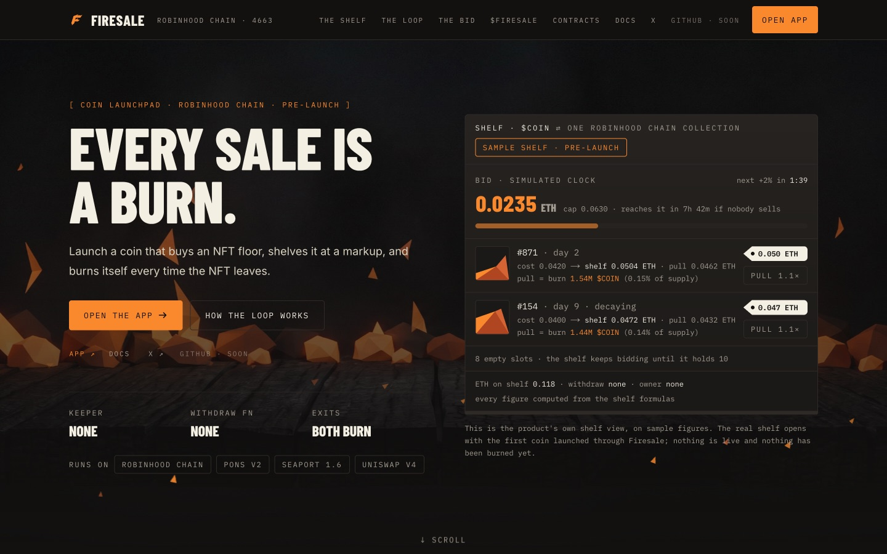
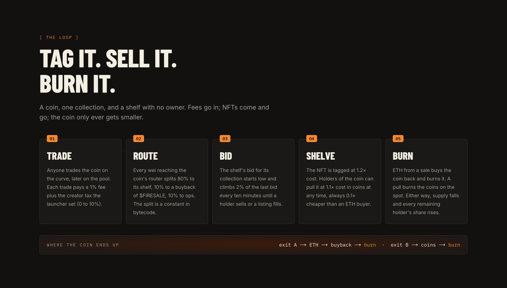
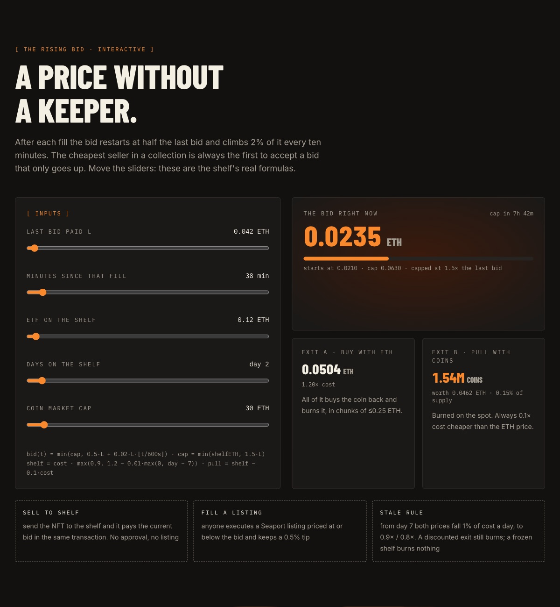
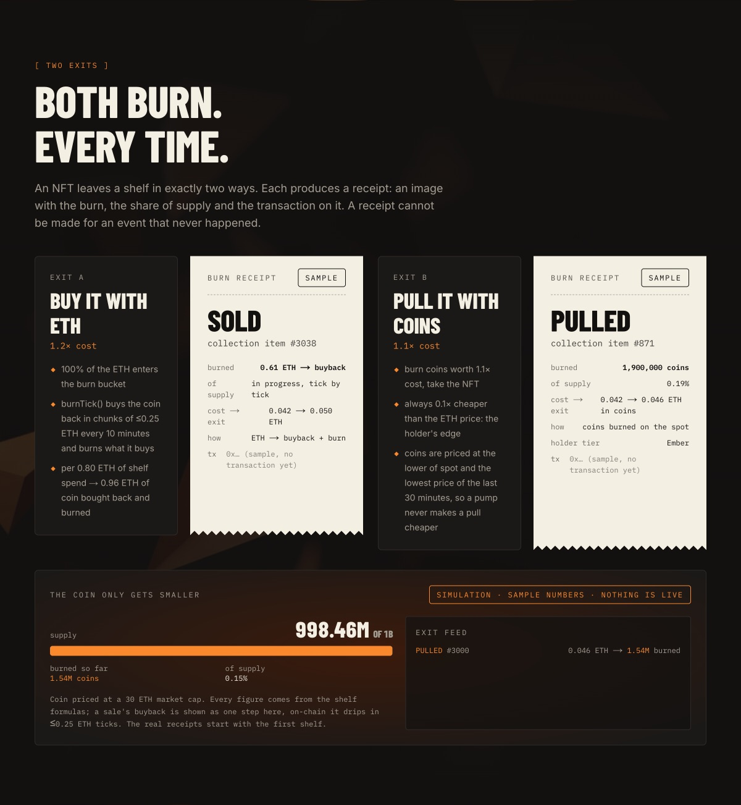
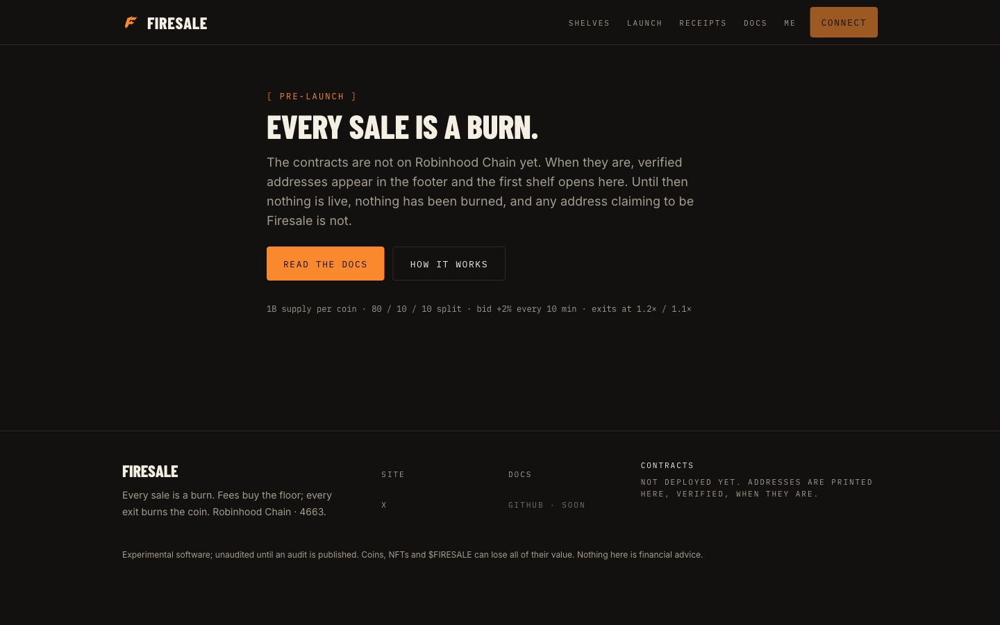

<div align="center">


# Firesale

### Every sale is a burn.

Launch a coin that buys an NFT floor, shelves it at a markup, and burns itself every time the NFT leaves.

[](https://robin.etherscan.io)
[](https://app.usefiresale.app)
[](#-status)
[](https://usefiresale.app/docs)
[](https://getfoundry.sh)
[](https://app.usefiresale.app)

[Website](https://usefiresale.app) · [Docs](https://usefiresale.app/docs) · [App](https://app.usefiresale.app) · [X / @usefiresale](https://x.com/usefiresale) · [GitHub / getfiresale](https://github.com/getfiresale)

</div>

<br />

<p align="center">
  
</p>

---

## What is Firesale

Firesale is a coin launchpad on **Robinhood Chain**. Every coin launched here gets its own **shelf**: a contract with no owner and no withdraw function that uses the coin's trading fees to buy one NFT off its paired collection's floor, lists it at **1.2x** cost, and burns the coin every time that NFT leaves.

Fee-funded NFT launchpads already proved the demand. They also give the NFT away, and the coin that paid for it gets nothing back. Firesale closes that loop.

- **Every exit burns.** Bought with ETH or pulled with coins, the coin that paid for the NFT is destroyed.
- **No keeper in the money path.** A rising bid finds the price. No oracle, no bot with special rights.
- **Ownerless shelves.** No admin key, no pause switch, no upgrade path, no withdraw function.
- **On-chain only.** Every buy settles in the shelf itself, on Robinhood Chain, from block one.
- **No raffles.** Nobody has to win for every holder's share to rise.

---

## ⚙️ Core Mechanics

| | Rule |
|---|---|
| **Fee split** | every wei reaching a coin's router: **80%** shelf · **10%** buy and burn `$FIRESALE` · **10%** ops. A constant in bytecode |
| **Pairing** | one coin, one collection, fixed at launch forever |
| **Bid** | restarts at **half** the last bid, climbs **2%** of it every **10 minutes** |
| **Bid cap** | **1.5x** the last fill, stepping up **25%** per full day at the cap |
| **First bid** | ramps from zero to the full budget over **24 hours** |
| **Shelf price** | **1.2x** cost (exit A, ETH) |
| **Pull price** | **1.1x** cost, paid in coins (exit B), always **0.1x** under the ETH price |
| **Stale rule** | from **day 7**, both prices fall **1%** of cost a day, down to **0.9x / 0.8x** |
| **Capacity** | up to **10 NFTs** per shelf, one collection only |
| **Buyback** | chunks of at most **0.25 ETH**, **10 minutes** apart |
| **Fill tip** | **0.5%** of a filled Seaport listing, paid by the shelf to the caller |

---

## 🔁 The Loop

<p align="center">
  
</p>

```
   trader buys / sells $COIN   (Pons V2 curve, then Uniswap v4)
              │  1% fee + creator tax 0 to 10%
              ▼
       ┌─────────────┐ ── 10% ──► buy + burn $FIRESALE
       │   ROUTER    │ ── 10% ──► ops
       └──────┬──────┘
              │ 80%
              ▼
       ┌─────────────┐   bid climbs every 10 minutes
       │    SHELF    │◄──── a holder sends the NFT,
       │  ETH + NFT  │      or a Seaport listing ≤ bid is filled
       │ no withdraw │
       └──────┬──────┘
       ┌──────┴──────────────────────┐
       ▼                             ▼
  EXIT A: buy with ETH (1.2x)    EXIT B: pull with coins (1.1x)
  ETH buys the coin back         coins are burned
  and burns it                   on the spot
       └──────────────┬──────────────┘
                      ▼
       $COIN supply falls, every holder's share rises
```

---

## 📈 A Price Without a Keeper

A shelf never guesses what a floor is worth. It asks, and keeps asking a little louder, until the cheapest seller in the collection accepts.

```
L = last bid, t = seconds since that fill

bid(t)      = min(cap, 0.50·L + 0.02·L·floor(t / 600))
cap         = min(shelfETH, 1.5·L·1.25^k)        k = full days spent at the cap
shelfPrice  = cost · max(0.90, 1.20 − 0.01·max(0, day − 7))
pullPrice   = shelfPrice − 0.10·cost
coinsToBurn = pullPrice / min(spot, lowest price of the last 30 minutes)
```

<p align="center">
  
</p>

The shelf buys in two permissionless ways:

- **Sell to the shelf.** A holder sends the NFT to the shelf with a minimum price. The shelf pays the current bid in the same transaction, or the transfer reverts. No approval is needed, so it also works on collections that refuse operator transfers.
- **Fill a listing.** Anyone can execute a Seaport 1.6 listing priced at or below the bid and keep a 0.5% tip.

---

## 🔥 Two Exits, Both Burn

| | Exit A: buy with ETH | Exit B: pull with coins |
|---|---|---|
| **Price** | 1.2x cost | 1.1x cost, in coins |
| **Where the value goes** | 100% of the ETH enters the burn bucket | the coins are burned immediately |
| **Burn** | `burnTick()` buys the coin back in ≤0.25 ETH chunks, 10 minutes apart | at once, in the same transaction |
| **Math** | 0.80 ETH of shelf spend becomes 0.96 ETH of coin burned | always 0.1x cheaper than the ETH price |
| **Guard** | each chunk pays at most 10% above the last recorded price | coin priced at the lower of spot and the lowest price of the last 30 minutes |

<p align="center">
  
</p>

Every exit produces a **burn receipt**, built from the on-chain event and carrying the transaction. A receipt cannot be made for an event that never happened.

---

## 🧱 The Shelf

<table>
<tr>
<td width="42%" valign="top">

</td>
<td valign="top">

**It holds**
- ETH: the bid budget, plus a separate burn bucket
- up to 10 NFTs from exactly one collection

**It can**
- claim its fees from the launchpad escrow
- bid for, and buy, one floor NFT at a time
- sell a shelf NFT at the shelf price
- release a shelf NFT to anyone who burns the pull price
- buy its own coin back and burn it

**It cannot**
- withdraw ETH to any address
- move an NFT except through a sale or a pull
- change its collection, its split or its prices
- be paused, upgraded or re-owned by anyone, including the team

</td>
</tr>
</table>

---

## 🏗️ Architecture

```
    users / bots
         │
         ▼
    usefiresale.app          landing page + docs (Next.js)
    app.usefiresale.app      app: shelves, launch, receipts (Next.js + viem)
         │                              ▲
         │ transactions                 │ reads events, renders receipts
         ▼                              │
    ┌──────────────── ROBINHOOD CHAIN (4663) ─────────────────┐
    │  FiresaleLauncher ── deploys ──► FiresaleShelf (1/coin)  │
    │  CollectionRegistry            PlatformBurner            │
    │         │                 │                 │           │
    │    Pons V2 curve     Seaport 1.6       Uniswap v4        │
    │    + fee escrow      (buy / sell)      (post-graduation) │
    └──────────────────────────────────────────────────────────┘
         ▲
         │ permissionless calls only (harvest, burnTick, poke)
    keeper bot            no special rights, only spends gas
```

| Contract | Role |
|---|---|
| `FiresaleShelf` | one per coin. No owner, no withdraw, no upgrade |
| `FiresaleLauncher` | deploys a shelf, which launches the coin with itself as deployer and fee recipient |
| `CollectionRegistry` | collection allowlist. Owner key behind a public 48-hour delay, future launches only |
| `PlatformBurner` | collects the 10% slices, buys and burns `$FIRESALE` |
| `ShelfDeployer` · `CoinBuyer` | CREATE2 deployment helper · curve and Uniswap v4 buy-and-burn logic |

| Shelf function | What it does |
|---|---|
| `harvest()` | claim escrow, split 80 / 10 / 10 |
| `currentBid()` | the rising-bid formula, view |
| `onERC721Received(...)` | a holder sends the NFT, the shelf pays the bid |
| `fillListing(order, tokenId)` | execute a Seaport listing at or under the bid, 0.5% tip |
| `buy(tokenId)` | exit A at the shelf price |
| `pull(tokenId, maxCoins)` | exit B, burns coins |
| `burnTick()` | next buyback chunk and burn |
| `poke()` | record the coin price for the pull guard |

---

## 🛡️ Security Model

| Attack | Defence |
|---|---|
| Overpriced or fake floor sold into the shelf | the bid starts low and only rises, the cheapest seller wins, a cap per fill, allowlisted collections only |
| Sandwich around the buyback | chunks of at most 0.25 ETH, ten minutes apart, each at most 10% above the last recorded price |
| Pump the coin to make a pull cheaper | pull priced at the lower of spot and the lowest price of the last 30 minutes, the lowest price in a block wins |
| Malicious NFT contract | standard ERC-721 only, allowlisted, reentrancy guards, checks-effects-interactions on every transfer |
| Griefing with dust NFTs | only the paired collection, a 10-slot cap |
| A 1-wei self-listing to reset the bid | a listing fill anchors the next bid to the bid, never to the listing price |

**Trust points that cannot be removed**, disclosed on [usefiresale.app/docs](https://usefiresale.app/docs):

- The launchpad's owner can set a new creator-fee recipient for any coin after a 3-day timelock. Future fees can move. What already reached a shelf cannot.
- After graduation, some pool-fee conversions may need the launchpad's operator to settle.
- The launchpad can switch new launches off.
- The registry owner key decides which collections are offered for future launches, behind a public 48-hour delay. It cannot touch an existing shelf, and it moves to a multisig once one runs on Robinhood Chain.

---

## 🧪 Status

<p align="center">
  
</p>

The app runs in **pre-launch** mode at [app.usefiresale.app](https://app.usefiresale.app). The contracts are **not on mainnet yet**. Until they are, nothing is live, nothing has been burned, and any address claiming to be Firesale is not.

Every piece of the loop was run on a fork of Robinhood Chain, against the real launchpad, the real Seaport and real NFTs:

| Proof | Result |
|---|---|
| the shelf is both deployer and fee recipient on Pons V2 | ✅ |
| fees reach the shelf and split exactly 80 / 10 / 10 | ✅ |
| a holder sells by sending the NFT, even on collections that refuse operator transfers | ✅ |
| a shelf fills a Seaport 1.6 listing, and a 1-wei listing cannot reset the bid | ✅ |
| buy and burn from a contract on the curve, before graduation | ✅ |
| buy and burn through Uniswap v4, after graduation | ✅ |
| a pump in the same block never makes a pull cheaper | ✅ |
| the launch-second snipe tax lands on the shelf | ✅ |
| ongoing pool-fee sweeps after graduation without the launchpad's operator | ⏳ open |

---

## 🪙 $FIRESALE at a Glance

| | |
|---|---|
| **Supply** | 1,000,000,000 |
| **Launch** | through Firesale itself, on the Pons V2 curve |
| **Curve** | graduates at 4.2 ETH into a Uniswap v4 pool |
| **Paired with** | one Robinhood Chain collection, announced at launch |
| **Creator tax** | 1%, routed 80 / 10 / 10 like every coin |
| **Presale** | none |
| **Team allocation** | none. Any team buy happens on the public curve, with the address disclosed |
| **Platform burn** | 10% of every coin's fees buys and burns `$FIRESALE` |

Holding `$FIRESALE` never buys a discount, a better price or priority on a shelf. The product is identical for every wallet.

| Tier | Hold | Perks |
|---|---|---|
| Visitor | 0 | launch, trade, pull, buy, sell to shelf, every receipt and page |
| Spark | 500K | badge on receipts, 1 collection vote a week |
| Ember | 2.5M | badge, 3 votes a week, nominate a collection for review |
| Blaze | 10M | badge, 10 votes a week, one curated featured-shelf request a month |

---

## 🗺️ Roadmap

| Phase | When | Focus |
|---|---|---|
| **0 · Proof** ✅ | week 1 | 15 fork proofs on the real venue, fresh keys, review scope written before code freeze |
| **1 · MVP** 🔥 | weeks 2 to 4 | app in pre-launch, contracts verified on mainnet with v1 caps, 3 to 5 collections, keeper bot, `$FIRESALE` launched through Firesale |
| **2 · Growth** | months 2 to 3 | tiers and weekly collection votes, Shelf Watch and alerts, sell-to-shelf collection pages, external review, cap raises, bug bounty |
| **3 · Scale** | months 4 to 6 | shelf NFTs on public marketplaces, creator dashboard, embeddable floor-bid widget |
| **4 · Ecosystem** | 6 to 12 months | collection-endorsed coins, multi-collection shelves, more collections only if every buy settles on-chain in the shelf |

---

## ⚠️ Scam Warning

- `$FIRESALE` has **not launched**. Any token using the name before the official announcement is not ours.
- There is **no presale, no whitelist and no private allocation**. Anyone offering one in a DM is a scammer.
- Contract addresses are published only on [usefiresale.app](https://usefiresale.app), in the app footer, by [@usefiresale](https://x.com/usefiresale), and in [github.com/getfiresale](https://github.com/getfiresale). Verify them on [robin.etherscan.io](https://robin.etherscan.io) before you sign anything.

---

## 🔗 Links

| | |
|---|---|
| Website | [usefiresale.app](https://usefiresale.app) |
| Docs | [usefiresale.app/docs](https://usefiresale.app/docs) |
| App | [app.usefiresale.app](https://app.usefiresale.app) |
| X | [@usefiresale](https://x.com/usefiresale) |
| GitHub | [github.com/getfiresale](https://github.com/getfiresale) |
| Explorer | [robin.etherscan.io](https://robin.etherscan.io) |

<br />

<div align="center">


<sub>Experimental software, unaudited until an audit is published. Coins, NFTs and $FIRESALE can lose all of their value. Nothing in this repository is financial advice. Robinhood Chain, Pons, Seaport and Uniswap are third-party protocols with no affiliation to Firesale.</sub>

</div>
